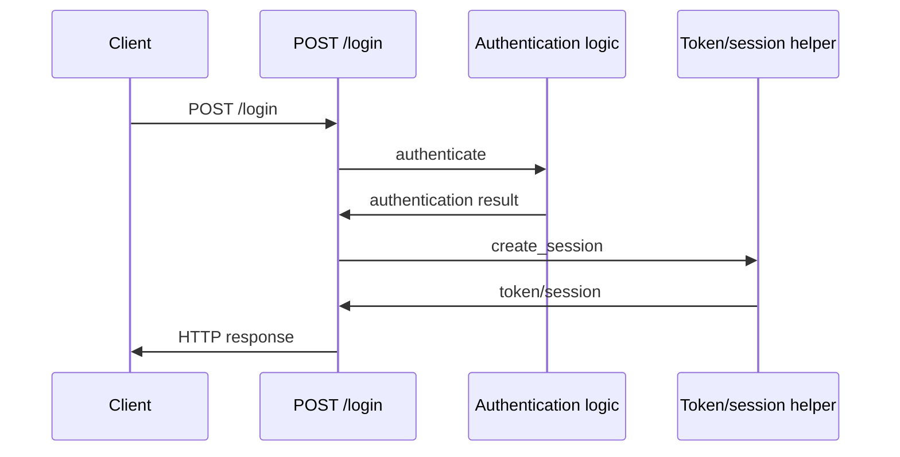

# Authentication sequence

## Evidence

- [backend/app/routes.py:7](../backend/app/routes.py#L7)
- [backend/app/routes.py:9](../backend/app/routes.py#L9)
- [backend/app/routes.py:12](../backend/app/routes.py#L12)

## Limits

- Sequence is inferred from static call sites; branch order and runtime behavior require source review
