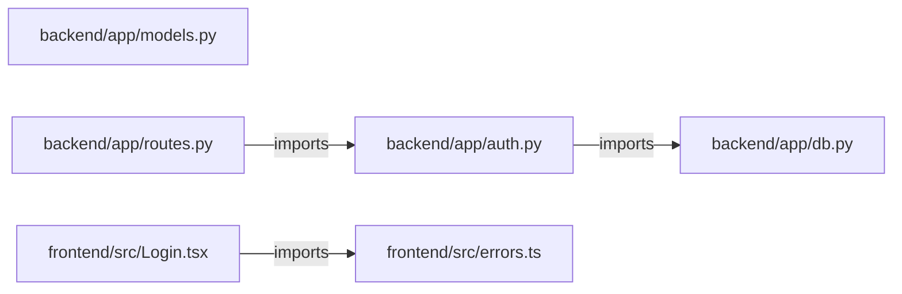

# Component diagram

## Evidence

- [backend/app/auth.py:1](../backend/app/auth.py#L1)
- [backend/app/db.py:1](../backend/app/db.py#L1)
- [backend/app/models.py:1](../backend/app/models.py#L1)
- [backend/app/routes.py:1](../backend/app/routes.py#L1)
- [backend/app/routes.py:2](../backend/app/routes.py#L2)
- [frontend/src/Login.tsx:1](../frontend/src/Login.tsx#L1)
- [frontend/src/Login.tsx:2](../frontend/src/Login.tsx#L2)
- [frontend/src/errors.ts:1](../frontend/src/errors.ts#L1)
