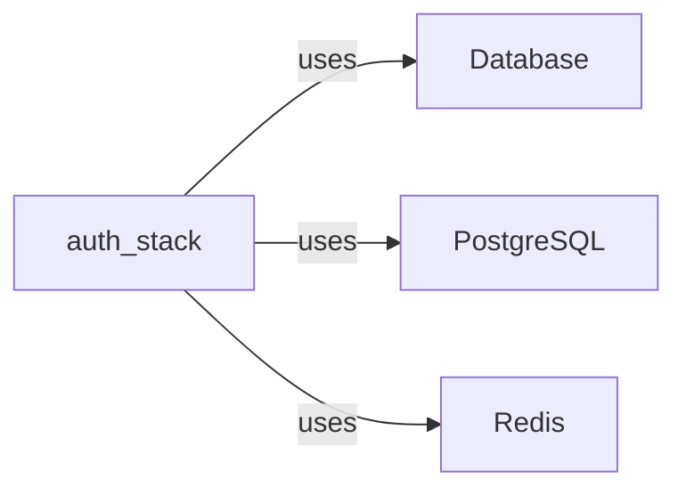

# Service dependencies

## Evidence

- [backend/.env.example:1](../backend/.env.example#L1)
- [backend/.env.example:2](../backend/.env.example#L2)
- [backend/app/models.py:1](../backend/app/models.py#L1)
