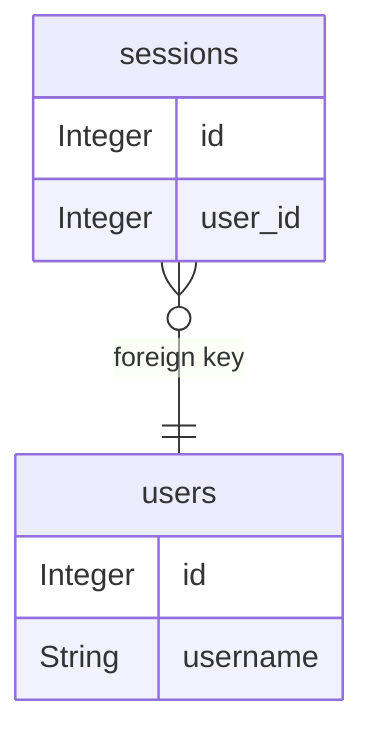

# Database ER diagram

## Evidence

- [backend/app/models.py:4](../backend/app/models.py#L4)
- [backend/app/models.py:10](../backend/app/models.py#L10)
- [backend/app/models.py:13](../backend/app/models.py#L13)
